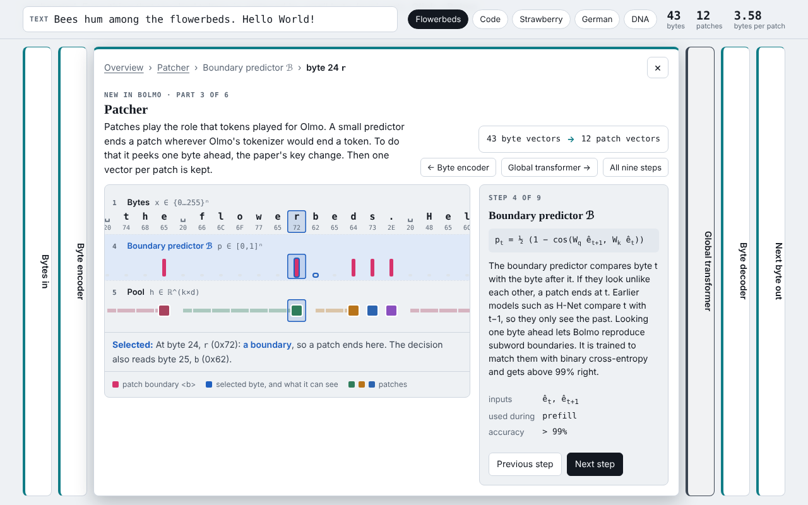

# Bolmo Explainer

An interactive walkthrough of [Retrofitting language models to operate over bytes](https://doi.org/10.1038/s41586-026-11111-4) (Minixhofer et al., *Nature*, 2026), in the style of [Transformer Explainer](https://poloclub.github.io/transformer-explainer/).

The paper takes a finished subword model, Olmo 3 7B, and rebuilds it to read and write raw bytes. The result is Bolmo. The transformer is kept, the parts that touched tokens are replaced by small byte-level parts, and the conversion costs under 1% of a typical pretraining budget.



**Open it:** `index.html` is one self-contained file of about 210 KB. It needs no network and fetches no fonts. Download it and open it in a browser, or turn on GitHub Pages for this repository (Settings → Pages → deploy from the `main` branch, root folder) to get a link.

## What you can do

| Section | Control | What it shows |
| --- | --- | --- |
| Context | your own text | the same text as characters, as Olmo 3's tokens and as Bolmo's bytes, and which token hides the most letters |
| Overview (Fig. 1) | click a part | Olmo 3's pipeline above Bolmo's: the transformer kept, the token parts swapped for six byte-level parts, with live counts |
| Zoom | a part, then a step, then a byte | the part expands in place and the other five shrink to tabs beside it, as in Transformer Explainer. It shows the part's own steps on your text, then one byte's column: what it can see, which patch it joins, what it is trained to predict. The deepest view shows all nine steps at once |
| One byte of future | lookahead slider, 0 to 4 bytes | why subword boundaries depend on the next byte, and how often a cut-off tokenizer gets them right |
| Generation | play, step | the 512-entry output (256 bytes, and 256 bytes followed by a boundary) and when the global model runs |
| Training | stage 1 / stage 2 | what is frozen, which losses are on, and their weights |
| Efficiency (Fig. 2, Ext. Data Fig. 3) | bytes-per-patch slider | merging patches on your text, the accuracy–compute frontier, decoding speed |
| Results (Table 1, Fig. 3) | model family, baselines on or off | byteified vs. source model per category, and the task-arithmetic IFEval jump |
| Quiz | five questions | each answer explains itself |

## What is real and what is drawn

- **Real, computed in the page:** UTF-8 bytes, subword boundaries, patches, the longest-suffix token added to each byte's embedding, depooling, training targets, the fused output index, and patch merging. The tokenizer is byte-level BPE over the first 24,576 merges of `cl100k_base`, enough to split "flowerbed" into ` flower` + `bed` as in the paper's Fig. 1.
- **From the paper:** every score, speed and hyperparameter. Fig. 2, Fig. 3 and Extended Data Fig. 3 only print values as plotted points, so those were read off the figures. Their captions in the page say so.
- **Drawn, not run:** vectors are boxes. No model weights run in the page. The boundaries shown are the targets Bolmo's predictor is trained to match, which it does more than 99% of the time.

## The checks

- The in-page tokenizer was compared with `js-tiktoken` on four texts, including German and an emoji. All four gave identical token IDs.
- Three pairs worked out from the paper's argument behave as the paper says. `Hello World!` and `Hello Wor!` share their first 9 bytes, but only the second ends a token after `W`. The same holds for `among the flowers` / `among the flowerbed` (after `r`) and `I understand.` / `I under.`.
- On the default text, replaying the tokenizer with *k* bytes of lookahead matches the full-text boundaries 26%, 86%, 93%, 95% and 100% of the time for *k* = 0 to 4. *k* = 0 means a token ends at every byte. This is a crude stand-in. The paper's learned predictor gets above 99% with one byte.
- The page was rendered in headless Chromium at 1440×900 and 1280×800 (light and dark) and at 390 px wide. Every expanded part fits on one screen at those desktop sizes. There were no console errors and no horizontal scroll.

## Editing

The page is built from two files in `src/`. `head.html` holds the title and styles. `body.html` holds the markup and script, with a `__VOCAB_GZ_B64__` placeholder for the tokenizer vocabulary.

```sh
npm install
npm run build   # writes index.html
```

The build reads the `cl100k_base` ranks from `js-tiktoken`, keeps the first 24,576, and embeds them gzipped and base64-encoded. The page unpacks them with `DecompressionStream`, which current Chrome, Edge, Firefox and Safari 16.4+ support.

## How it was made

Built with Claude Code from the paper PDF, in October 2026. Reading list entry: [awesome-learning-with-ai](https://github.com/kirilklein/awesome-learning-with-ai).

## License

Code and text: [MIT](LICENSE). The paper is CC BY 4.0. The embedded tokenizer data is MIT-licensed. See [THIRD_PARTY_NOTICES.md](THIRD_PARTY_NOTICES.md).
